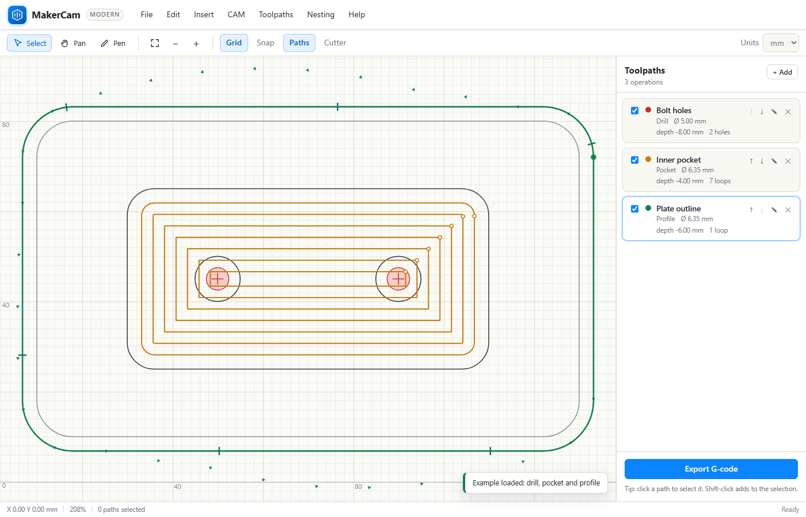

# MakerCam Modern

A working, modern reimplementation of **MakerCam / PartKam** — the browser-based
2.5D CAM application originally written in ActionScript 3 for Adobe Flash.

The original `makercam.swf` in this repository was inspected, decompiled, and
matched to the open-source PartKam source by Jack Clark. This project re-creates
its core workflow in **TypeScript + HTML5 Canvas**, with no Flash runtime and no
server-side dependencies.

> **Safety:** Always inspect and simulate generated G-code before running it on a
> machine. This is CAM software; cutters, stock, and machines can be damaged by
> incorrect parameters, units, or zero positions.



---

## Quick start

### Use the built app (no installation)

Open **`dist/index.html`** in a modern browser (Chrome, Edge, Firefox, Safari).

On Windows you can double-click **`start.bat`**.

New to it? Open the app and click **Load example** on the empty-canvas card (or
**Help → Load example project**) to get a ready-made plate with a drilled,
pocketed and profiled toolpath set. You can also deep-link straight to it:
`dist/index.html?example=1`.

Everything runs locally in the browser. Drawings are never uploaded.

### Develop

Requirements: Node.js 20.19+ or 22.12+ (Node 24 LTS recommended).

```bash
npm install
npm run dev      # build + serve at http://localhost:5173
npm test         # unit tests
npm run build    # writes dist/app.js, dist/styles.css, dist/index.html
```

The browser checks under `tools/` launch Microsoft Edge by default; set
`EDGE_PATH` (or `CHROME_PATH`) to use another Chromium installation.

---

## Native Windows app

A C#/WPF port lives in [`dotnet/`](dotnet/README.md). It carries the same CAM
engine — verified byte-for-byte against this TypeScript build — and adds native
menus, file dialogs and a Windows executable:

```powershell
dotnet run --project dotnet/src/MakerCam.App
```

An MSI installer (Start menu shortcut, uninstall entry, and “Open with
MakerCam” for SVG) is built with `dotnet/installer/build.ps1`.

Projects saved by either version open in the other.

---

## What was converted

The SWF is a Flash 10 / SWF v13 file (zlib-compressed `CWS`) containing one
355 KB `DoABC` block. FFDec export shows 154 classes, including all
`com.partkart.*` classes (`Path`, `CutPath`, `PostProcessor`, `SceneGraph`,
`ProfileCutObject`, `PocketCutObject`, `DrillCutObject`, `Nest`, …) plus the
Flash component skins. That class set matches the open-source
[`Jack000/PartKAM`](https://github.com/Jack000/PartKAM) project (LGPL-3.0),
which was used as the reference for this port.

The port preserves the original CAM model:

| Original | This port |
| --- | --- |
| SVG import and path model | `src/svg.ts`, `src/geom.ts` |
| Offset-based profile/pocket | `src/cam.ts` using Clipper offsets |
| Follow-path and drill cycles | `src/cam.ts` |
| Tabs | `src/cam.ts` + `src/gcode.ts` |
| G-code post-processor | `src/gcode.ts` |
| Project save/load (SVG + metadata) | `src/project.ts` |
| Nesting | `src/cam.ts` (deterministic packer) |
| Flash UI / event handling | `src/main.ts`, `src/render.ts`, `src/ui.ts` |

---

## Features

**Drawing**
- Import SVG: paths, rect, circle, ellipse, line, polyline, polygon, groups,
  transforms, `viewBox`, physical units, and basic `<use>`.
- Insert circles, ellipses, rectangles, rounded rectangles, polygons, and stars.
- Select, shift-select, marquee-select, move, copy/paste, delete.
- Scale, rotate, and skew selections.
- Pen tool for polylines.
- Pan (Space / middle mouse / tool), wheel zoom, adaptive grid, snap, fit view.
- Undo/redo history.

**CAM**
- **Profile** — outside or inside, cutter-radius compensation, step-down, tabs,
  climb/conventional direction.
- Operation list ordering controls G-code order (use the ↑/↓ buttons); the
  selected operation is highlighted on the canvas.
- **Pocket** — concentric offsets, step-over percentage, roughing clearance.
- **Follow path** — cut directly on open or closed geometry.
- **Drill** — path centres or a fill pattern with peck depth.
- **Holes along path** — place a fixed number of evenly spaced holes along open
  or closed geometry and peck-drill them to the target depth.
- Tool changes, safety height, stock surface, target depth, feed/plunge rates.
- Live toolpath preview with direction arrows, start points, tabs, and an optional
  cutter-width overlay.

**Output**
- G-code download (`.nc`) in millimetres (`G21`) or inches (`G20`).
- GRBL-compatible G-code: only GRBL 1.1-supported commands are emitted. GRBL has
  no automatic tool changer, so jobs with several cutter sizes stop at an `M0`
  pause with a comment naming the next tool; resume when it is mounted.
- Older `.nc` files that still contain `T.. M6` can be cleaned with
  `scripts/strip-toolchanges.ps1` (supports `-WhatIf`, `-Backup`, and
  `-KeepComment`).
- Project save as a normal SVG that also carries CAM parameters; it can be
  reopened here, and files written by the original MakerCam/PartKam are read too.

**Nesting**
- Choose a closed material boundary, then pack the generated toolpaths inside it
  with a configurable gap and rotation set.

---

## Intentional differences from the Flash original

These are deliberate engineering choices, not missing UI polish:

1. **Offsetting** uses [Clipper](https://sourceforge.net/projects/polyclipping/)
   polygon offsetting instead of the original's rasterize-and-hit-test trick. The
   round-cutter geometry is equivalent and more robust, but offsets are polygonal.
2. **G-code is G1-only.** Curves and offsets are flattened to polylines at the
   configured tolerance (default 0.02 mm), so G2/G3 arcs are not emitted. This is
   universally compatible; lower the tolerance in **Preferences** for smoother
   curves (at the cost of more lines).
3. **Nesting** is a deterministic bottom-left packer using buffered convex-hull
   collision shapes, not the original genetic algorithm + bitmap collision.
   It is fast and predictable, but less optimal on dense layouts.
4. **Some interactive CAD features are not ported:** the freehand sketch tool,
   per-node point editing, the background-image overlay, PartKart factory
   ordering, and the Flash component skins. The UI is rebuilt with modern HTML.
5. **SVG `px` resolution defaults to 96 px/inch** (CSS standard). For files made
   for Illustrator/Flash-era workflows, set 72 px/inch in **Edit → Preferences**
   to match MakerCam's original default.
6. Units are handled internally in **millimetres** (the original mixed inches,
   centimetres, and millimetres). Display/output units can be switched at any
   time without changing the stored geometry.

---

## Code layout

```
index.html            app shell (source; build copies to dist/)
src/
  main.ts             application controller, tools, commands, dialogs wiring
  geom.ts             points, line/quad/cubic segments, matrices, SVG path data
  svg.ts              SVG importer and path serialiser
  cam.ts              loop construction, Clipper offsetting, toolpaths, nesting
  gcode.ts            G-code post-processor (profiles, pockets, drills, tabs)
  project.ts          project save/load (own format + original MakerCam format)
  render.ts           Canvas renderer and view transforms
  ui.ts               modal dialogs, toasts, menu handling
  styles.css          UI styling (light/dark, responsive)
tests/                Vitest unit tests (geometry, CAM, G-code, SVG, projects)
scripts/build.mjs     esbuild bundle + static server
scripts/strip-toolchanges.ps1  removes legacy T.. M6 lines from old .nc files
dist/                 ready-to-open build (app.js, styles.css, index.html)
tools/                analysis, screenshots, and browser smoke tests
```

The SWF and the extracted source/decompilation live under `tools/` for
traceability. Generated screenshots and test artifacts are also in `tools/screens/`.

---

## Verification performed

- SWF header/tag/ABC analysis and FFDec decompilation of all 154 classes.
- 55 unit tests covering geometry, SVG import/export, offsets, self-intersecting
  and overlapping paths, toolpaths, G-code, and project round-tripping (including
  files in the original MakerCam format).
- Headless Microsoft Edge end-to-end checks: import, select, pocket, follow,
  profile + tabs, G-code download, save/reopen project, undo/redo, pen, drag,
  marquee, zoom, toolpath selection, and nesting.

---

## Contributing

Contributions are welcome. See [CONTRIBUTING.md](CONTRIBUTING.md) for development
setup, testing, and pull request guidance. By participating you agree to follow
the [Code of Conduct](CODE_OF_CONDUCT.md). Report security issues privately as
described in [SECURITY.md](SECURITY.md).

---

## License and attribution

This is a derivative work of **PartKam / MakerCam** by **Jack Clark**, licensed
under the **GNU Lesser General Public License v3.0** (LGPL-3.0).
See [`LICENSE`](LICENSE). Original project:
<https://github.com/Jack000/PartKAM>.

The bundled polygon engine is **Clipper** by Angus Johnson (JavaScript port by
Timo, `clipper-lib`), used under the **Boost Software License 1.0**. See
[`THIRD_PARTY_NOTICES.md`](THIRD_PARTY_NOTICES.md).

“MakerCam” and “PartKam” are used descriptively to identify the software this
project ports; no affiliation with the original authors is implied.
