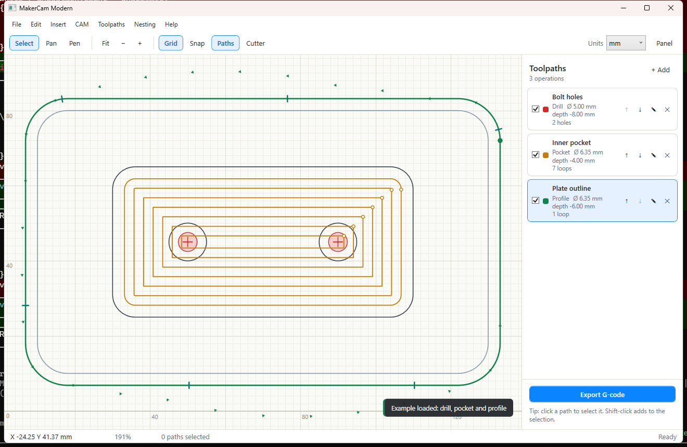

# MakerCam for Windows

A native C# port of MakerCam Modern, the PartKam/MakerCam 2.5D CAM application.
The original was ActionScript 3/Flash; the web port is TypeScript/Canvas; this
one is C# and WPF.



**Status:** the CAM core and the desktop UI are both ported. Project files are
interchangeable with the web app.

## Run it

```powershell
dotnet run --project dotnet/src/MakerCam.App
```

Or build and launch the executable:

```powershell
dotnet build dotnet/MakerCam.slnx -c Release
dotnet/src/MakerCam.App/bin/Release/net10.0-windows/MakerCam.exe
```

Requires the .NET 10 SDK (Windows). Use `--example` to open the demo project at
startup.

## Desktop behaviour

- **Drag and drop**: drop an SVG or MakerCam project onto the window. Plain
  SVGs are added to the current drawing; project files replace it (with the
  usual unsaved-changes prompt).
- **Start card**: an empty document shows a start card. Press **Esc** to dismiss
  it and use the clear canvas — for example to drag a file in without clicking
  one of the card's buttons.
- **Unsaved changes**: the title shows `*` while the document is dirty.
  Closing the window, starting a new project, or loading a project/example
  offers **Save**, **Discard** or **Cancel**.
- **Window placement**: size, position and maximised state are restored on the
  next launch. The first launch (or `--reset-settings`) opens maximised, with an
  on-screen check in case a monitor was removed.
- **Recent files**: **File → Recent Files** lists up to ten recently opened
  SVG/project files, persisted in preferences. Missing files are pruned, and
  the submenu has a **Clear recent files** command.
- **DPI**: the executable declares PerMonitorV2, so the canvas and dialogs stay
  crisp when the window moves between monitors with different scaling.
- **Settings**: stored in `%APPDATA%\MakerCam\prefs.json`. Run the app with
  `--reset-settings` to return to defaults.
- **Icon**: `Assets/MakerCam.ico` is used by the window, the executable and the
  installer. Regenerate it with `dotnet/tools/make-icon.ps1`.

## What is here

```
dotnet/
  MakerCam.slnx
  src/MakerCam.Core/          net10.0 CAM library (no UI dependencies)
    Geometry/                 Vec, segments, Path, Matrix, Geom, SVG path data, shapes
    Svg/                      SVG import and path serialisation
    Cam/                      loops, Clipper offsetting, toolpaths, tabs, nesting
    Gcode/                    G-code post-processor
    Project/                  project save/load (own + original PartKam format)
  src/MakerCam.App/           net10.0-windows WPF desktop app
    Rendering/                world/screen transforms, DrawingContext renderer
    Controls/DrawingCanvas.cs host for the renderer
    Dialogs/                  generic field dialog (mirrors the web modal forms)
    Controller/AppController  tools, selection, undo, commands, files, nesting
    MainWindow.xaml           menus, toolbar, toolpath panel, status bar
    app.manifest              PerMonitorV2 DPI awareness
    Assets/MakerCam.ico       window/executable/installer icon
  installer/                  WiX MSI authoring and build script
    MakerCam.wxs              package, shortcut, registry associations
    license.rtf               LGPL notice shown by the installer
    build.ps1                 publish, sign, MSI build
  tests/MakerCam.Core.Tests/  xUnit tests (port, oracle parity and SVG scale)
  tools/oracle/               golden-fixture generator (runs the TypeScript app)
  tools/ui-smoke.ps1          end-to-end WPF smoke test through UI Automation
  tools/ui-nesting.ps1        boundary → nest → undo geometry test
  tools/ui-dragdrop.ps1       real Explorer drag-and-drop test
  tools/make-icon.ps1         regenerates the application icon
  tools/verify-associations.ps1 verifies an installed MSI and its .svg association
```

## Verification

### Core parity with the web app

The TypeScript implementation in `../src/` is the reference. The oracle bundles
it in memory, runs CAM scenarios, and writes
`tools/oracle/fixtures/oracle.json`. `OracleParityTests` replays every scenario
through the C# library and requires:

- **G-code and saved project SVG to match byte-for-byte** (including CRLF and
  unit conversion);
- imported paths, toolpath loops, tabs and drill points to match within
  **1e-9 mm**;
- warnings, operation ordering and parameter round-tripping to match exactly.

Regenerate the fixtures after changing either implementation:

```powershell
node dotnet/tools/oracle/oracle.mjs
dotnet test dotnet/MakerCam.slnx
```

The fixture is committed, so the C# tests need no Node.js.

### Desktop UI smoke test

`tools/ui-smoke.ps1` drives the real window through UI Automation and mouse
input: it inserts a shape through both dialog steps, loads the example, selects
a drawing path, selects all, copies/pastes/deletes with undo, reorders an
operation and undoes it, opens Preferences / Scale / Add-tabs dialogs through
the menus, saves and reopens a project through the native file dialogs and the Recent
Files menu, marquees, zooms, switches tools, draws a pen path, toggles the grid,
opens and closes the operation editor and G-code export form, then exercises the
`*` title marker and the Save/Discard/Cancel close prompt. It writes screenshots
to `%TEMP%\makercam-smoke`.

Not automated: Windows 10, ARM64 (out of scope) and mixed-DPI monitor
transitions were not available on the verification machine.

### Workflow tests

Two focused tests cover the remaining interactive workflows:

- `ui-nesting.ps1` — selects a closed boundary, sets it, nests the generated
  toolpaths, verifies the saved project geometry changed, then undoes and
  requires the saved project to match the pre-nest file byte-for-byte.
- `ui-dragdrop.ps1` — starts on an empty document, dismisses the start card
  with Esc, opens Explorer, performs a real OLE drag-and-drop of an SVG onto the
  app window, and verifies the import.

```powershell
powershell -ExecutionPolicy Bypass -File dotnet/tools/ui-nesting.ps1 `
  -ExePath dotnet/src/MakerCam.App/bin/Debug/net10.0-windows/MakerCam.exe
powershell -ExecutionPolicy Bypass -File dotnet/tools/ui-dragdrop.ps1 `
  -ExePath dotnet/src/MakerCam.App/bin/Debug/net10.0-windows/MakerCam.exe
```

Both need an interactive desktop session.

```powershell
powershell -NoProfile -ExecutionPolicy Bypass -File dotnet/tools/ui-smoke.ps1 `
  -ExePath dotnet/src/MakerCam.App/bin/Debug/net10.0-windows/MakerCam.exe
```

It needs an interactive desktop session.

## Keyboard shortcuts

| Key | Action |
| --- | --- |
| `V` / `H` / `P` | Select / Pan / Pen tool |
| Space (hold) | Temporary pan |
| `F` | Fit view |
| `G` | Toggle grid |
| `+` / `-` | Zoom in / out |
| `Ctrl+O` | Import SVG or open project |
| `Ctrl+S` | Save project |
| `Ctrl+E` | Export G-code |
| `Ctrl+Z` / `Ctrl+Y` | Undo / redo |
| `Ctrl+A` / `Ctrl+C` / `Ctrl+V` | Select all / copy / paste |
| `Delete` | Delete selection |
| `Esc` | Cancel pen/drag, or dismiss the start card |
| `Enter` | Finish pen path |

Mouse: wheel zooms at the cursor; middle/right drag pans; drag a path to move
it; drag empty space for a marquee; Shift-click adds to the selection.

## Porting notes

- **Rendering** is a direct port of `render.ts` to `DrawingContext`. The
  world-to-screen mapping, grid spacing, toolpath colours, direction arrows,
  tabs, cutter overlay and start markers match the web app.
- **Interaction** is a port of `main.ts`. It keeps the same tool state machine,
  hit-testing tolerances, undo snapshots (40 deep) and command routing.
- **Dialogs** replace the DOM modals with a reusable WPF form window; field
  definitions, validation messages and defaults are the same.
- **Files**: browser downloads/uploads become `OpenFileDialog`/`SaveFileDialog`.
  `localStorage` preferences become `%APPDATA%\MakerCam\prefs.json`.
- **WPF specifics**: the canvas redraws through `InvalidateVisual` (WPF
  coalesces paints), and text uses `FormattedText` with Segoe UI 11.

### Why the numbers agree with the web app

- **Clipper**: the `clipper.NetStandard2` 6.4.2 package is the same algorithm
  version as the JavaScript `clipper-lib` 6.4.2, so offsets produce the same
  integer geometry. Input coordinates use JavaScript's `Math.round` semantics.
- **Formatting**: `JsMath` reproduces `Math.round`, `toFixed` (halves away from
  zero) and the default number-to-string output used by the G-code and SVG
  writers.
- **Stable ordering**: JavaScript's stable `Array.sort` is mirrored with LINQ
  `OrderBy`/`ThenBy`, which are stable.

Known minor deviation: an unrecognised `type` string in a project file falls
back to `profile` (the web app carries the unknown string through). No known
MakerCam/PartKam file contains one.

### SVG scale and page size

Saved projects use millimetre user units with a matching page and viewBox, for
example `width="140mm" height="90mm" viewBox="0 0 140 90"`. One SVG unit is one
millimetre, so reopening preserves the physical dimensions regardless of the
`px/in` import setting.

The **original page size is preserved**. Importing a 140×90 mm SVG and saving
produces a 140×90 mm project; paths keep their positions and margins, and a
project reopened from disk keeps its stored page. Documents created from scratch
(with no imported page) fall back to a page fitted to their content.

`ProjectScaleTests` verify:

- page width/height/viewBox and path coordinates agree;
- an explicit page survives save → reopen → save byte-for-byte;
- page size is independent of content bounds;
- round-tripping preserves 100×50 mm at 72, 90, 96 and 120 px/in;
- switching display units does not change the file;
- curved geometry keeps its size and stays inside the page;
- Inkscape-style files (millimetre page, pixel-unit viewBox) import at the
  correct scale and save back without drift.

Independently, Inkscape 1.4.4 exports the app-saved 140×90 mm example at
529×340 px using 96 dpi (exact size 529.13×340.16; renderers round to whole
pixels). Inkscape prints a harmless `unknown type: svg:partkam-project`
warning about the custom metadata element and ignores it. The 0.2 mm on-screen
outline stroke is cosmetic and may extend 0.1 mm past the page edge; the
geometric dimensions are exact.

## Installer (MSI)

Build the installer:

```powershell
powershell -ExecutionPolicy Bypass -File dotnet/installer/build.ps1 -Version 1.0.5
```

Output: `dotnet/installer/artifacts/MakerCam-1.0.5-x64.msi` (about 49 MB; it
contains a self-contained 133 MB single-file build).

The MSI installs per machine (UAC prompt) and:

- installs to `Program Files\MakerCam` (the wizard lets the user change it);
- creates a Start menu shortcut and an Apps & Features uninstall entry;
- uses the application icon in Apps & Features;
- installs the `LICENSE` file;
- registers **Open with MakerCam** for `.svg` files;
- registers `MakerCam.exe` under `Applications` so Windows lists it by name in
  the Open With picker;
- upgrades older versions automatically (fixed `UpgradeCode` + `MajorUpgrade`).

### File associations

`.svg` is deliberately registered through `OpenWithProgids` **without becoming
the default handler**. Taking over `.svg` globally would hijack the user's
browser or drawing program. MakerCam therefore appears in Explorer's *Open
with* list, and the user chooses it for a project file. Explorer may need a
refresh or a sign-out before the new entry appears.

Passing a path on the command line opens that file, which is exactly what the
association uses:

```powershell
MakerCam.exe "C:\drawings\bracket.svg"
```

### Toolchain notes

- **WiX 5.0.2** is pinned in `dotnet/.config/dotnet-tools.json` and restored by
  the build script. WiX 6+ requires accepting the Open Source Maintenance Fee
  EULA; 5.x is used deliberately.
- The WiX UI extension is added to the per-user extension cache on the first
  build (network access required once).

### Signing (optional)

Builds are **unsigned by default**. To sign, supply a code-signing certificate:

```powershell
dotnet/installer/build.ps1 -Version 1.0.5 -SignThumbprint <thumbprint>
dotnet/installer/build.ps1 -Version 1.0.5 -PfxPath cert.pfx -PfxPassword <password>
```

The published executable and the MSI are then signed with SHA-256 and
timestamped. `-SkipSign` forces an unsigned build even if a certificate is
configured. Unsigned builds show Windows' standard "Unknown publisher" prompt
once during installation.

```powershell
Get-AuthenticodeSignature dotnet/installer/artifacts/MakerCam-1.0.5-x64.msi
```

Upgrade testing was performed across 1.0.0 → 1.0.1 → 1.0.2 → 1.0.3 → 1.0.4 → 1.0.5:
only the new product remains in Apps & Features, the old product key is gone, and
the installed version and associations update correctly.

### Uninstall and settings

The MSI removes the program files, shortcut, associations and cached icon. It
deliberately leaves per-user settings at `%APPDATA%\MakerCam\prefs.json` so a
reinstall preserves them; use `MakerCam.exe --reset-settings` to clear them.

Validate the package without installing it:

```powershell
msiexec /a dotnet\installer\artifacts\MakerCam-1.0.0-x64.msi /qn TARGETDIR=%TEMP%\makercam-admin
```

After installing, verify the registration and a real shell launch:

```powershell
powershell -ExecutionPolicy Bypass -File dotnet/tools/verify-associations.ps1 -Version 1.0.5
```

It checks the installed files, version and signing state; the Start-menu
shortcut, uninstall entry and cached product icon; the ProgID and OpenWith
registry entries; that MakerCam appears in the shell's `.svg` Open With handler
list; that the default `.svg` handler is untouched; and that opening a project
through the `MakerCam.Project` ProgID starts the app with the file loaded.

For a portable build with no installer:

```powershell
dotnet publish dotnet/src/MakerCam.App -c Release -r win-x64 --self-contained true `
  -p:PublishSingleFile=true -p:IncludeNativeLibrariesForSelfExtract=true `
  -o dotnet/publish
```

## Third-party

- **Clipper** by Angus Johnson — `clipper.NetStandard2` 6.4.2 (Boost Software
  License 1.0). See `../THIRD_PARTY_NOTICES.md`.
- This application is a derivative of PartKam/MakerCam by Jack Clark,
  LGPL-3.0. See `../LICENSE`.
